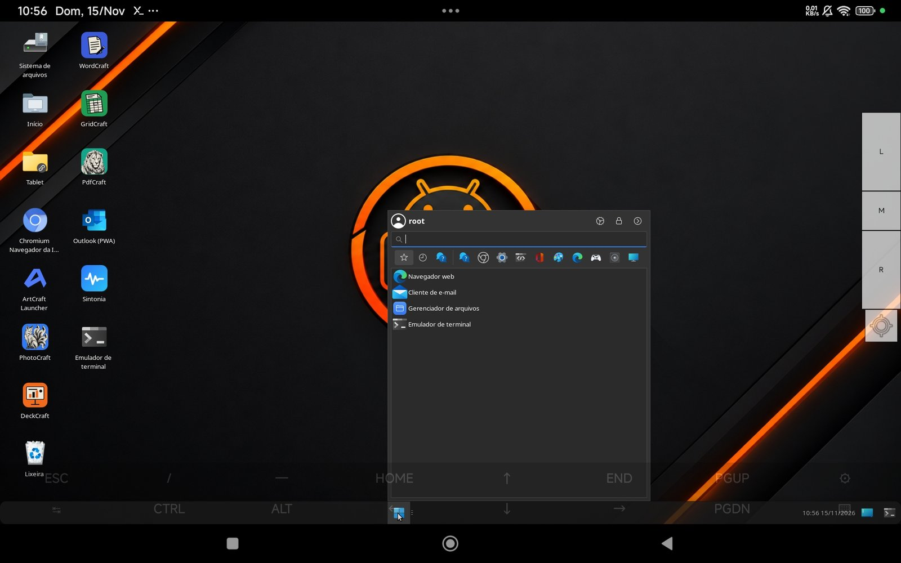
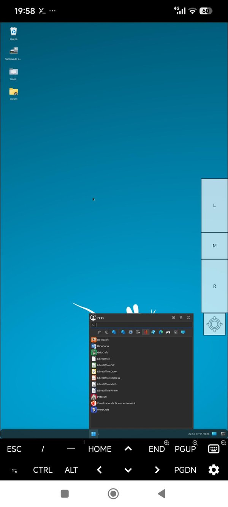
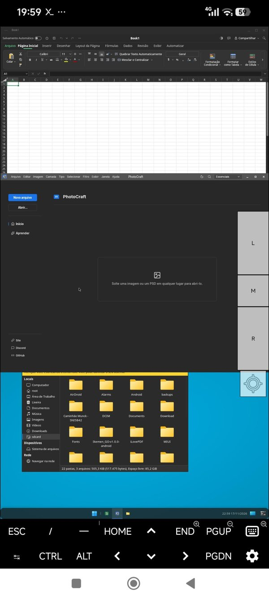

<p align="center">
  
</p>

<h1 align="center">Linux no Android</h1>

<p align="center">
  Abra o Ubuntu (udroid + XFCE) no seu tablet ou celular Android com um toque,<br>
  sem travas, sem tela preta e sem restos de sessão.
</p>

<p align="center">
  <a href="https://github.com/heitorcampos2/Linux-no-Android/raw/main/download/LinuxNoTablet.apk">
    
  </a>
</p>

<p align="center">
  
  
  
</p>

---

<p align="center"><sub>Versão 2.8 · Android 7 ou mais novo · <a href="download/LinuxNoTablet.apk">arquivo no repositório</a></sub></p>

## Capturas de tela

<p align="center">
  
  <br><sub>No tablet: Ubuntu com XFCE e visual Windows 11, apps ArtCraft na área de trabalho</sub>
</p>

<p align="center">
  
  &nbsp;
  
  <br><sub>No celular, na vertical: menu iniciar, GridCraft, PhotoCraft e a pasta do Android (sdcard)</sub>
</p>

## O que é

O **Linux no Tablet** é um app que controla o [Termux](https://github.com/termux/termux-app), o
[Termux:X11](https://github.com/termux/termux-x11) e o [udroid](https://github.com/RandomCoderOrg/fs-manager-udroid)
para você. Em vez de digitar comandos toda vez, você abre o app, toca em **Iniciar Ubuntu** e ele:

1. **Confere o último encerramento** — se sobrou Termux:X11 rodando, Ubuntu pela metade ou a trava da tela `:0`,
   ele avisa e limpa sozinho;
2. **Sobe o Termux:X11** e espera a tela `:0` ficar pronta de verdade;
3. **Inicia o Ubuntu com o XFCE** (em português, quando o pt-BR estiver instalado);
4. **Abre a tela do Termux:X11** só quando está tudo no ar.

Para sair, use **Sair** no menu do XFCE (o app desliga o Termux:X11 sozinho) ou o botão **Encerrar**,
que confere se não sobrou nenhum processo rodando. O botão **Histórico** mostra os últimos inícios,
encerramentos e erros.

## Instalação guiada (dentro do app)

A tela **Instalação** leva do zero ao Ubuntu funcionando, e cada etapa ganha ✔ quando está feita:

| # | Etapa | Como |
|---|---|---|
| 1 | Termux (GitHub) | botão que baixa a versão certa do seu processador e instala |
| 2 | Termux:X11 (GitHub) | botão que baixa o release *nightly* e instala |
| 3 | Liberar o Termux para o app | comando para colar + permissão |
| 4 | **Processos filhos (modo desenvolvedor)** | atalhos para *Sobre o tablet* e *Opções do desenvolvedor* |
| 5 | Atualizar o Termux | `pkg update && pkg upgrade` |
| 6 | Pacotes da tela, som e utilitários | `termux-x11-nightly`, `pulseaudio`, `procps`, `git` |
| 7 | udroid | instalação pelo repositório oficial |
| 8 | Ubuntu (`jammy:xfce4`) | `udroid install jammy:xfce4` |
| 9 | Ubuntu em português completo | idioma pt-BR + traduções dos programas |

Extras: **ArtCraft** (todos os apps + launcher), **LibreOffice** em pt-BR, **visual Windows 11 igual ao do tablet** (Fluent arredondado + ícones Win11 + barra com menu Iniciar),
**pasta Downloads do tablet** dentro do Ubuntu, **rotina de atualização** e **limpeza de espaço**.

Todas as etapas com comando têm **Copiar** e **Rodar no Termux** (abre uma aba do Termux para você acompanhar).

### Processos filhos (Android 12 ou mais novo)

O Android 12+ encerra os programas que rodam "por baixo" do Termux — o Ubuntu inteiro — e o Linux fecha sozinho
(`Process completed (signal 9)`). Para evitar:

1. **Configurações › Sobre o tablet** → toque 7 vezes em **Número da versão** (Xiaomi: *Versão do HyperOS/MIUI*);
2. **Opções do desenvolvedor** → ative **Desativar restrições de processos filhos** (Android 14+);
3. Bateria do Termux em **Sem restrições**.

No Android 12 e 13 (sem essa opção), rode de um computador com `adb`:

```sh
adb shell "/system/bin/device_config set_sync_disabled_for_tests persistent; /system/bin/device_config put activity_manager max_phantom_processes 2147483647"
adb shell settings put global settings_enable_monitor_phantom_procs false
```

## Primeira vez

1. Baixe e instale o APK (botão acima). O Android pede para permitir a instalação do navegador — é normal.
2. Abra o app: se faltar algo, ele abre a **Instalação** sozinho.
3. Na etapa 3, cole no Termux o comando que libera o app (`allow-external-apps = true`) e toque em **Dar permissão**.
4. Siga as etapas até o ✔ final e toque em **Iniciar Ubuntu**.

## Como funciona por dentro

- O app manda as rotinas para o Termux pela intenção oficial `com.termux.RUN_COMMAND` e recebe a saída de volta.
- As rotinas ficam em [`app/src/main/assets`](app/src/main/assets) (shell script) e vão em base64, para que
  `pgrep`/`pkill` nunca encontrem a própria rotina por engano.
- O `termux-exec` é carregado nas rotinas, porque o Termux não o carrega para comandos vindos de outro app
  (sem ele, o `#!/bin/bash` do udroid dá *bad interpreter*).
- O comando que roda dentro do Ubuntu vai como um script em `/tmp` (compartilhada com o Termux), porque o udroid
  quebra o comando nos espaços.
- Estado e histórico ficam em `~/.linux-no-tablet/` no Termux.

## Novidades da 2.8

- **Hora e data certas:** ao tocar em Iniciar, o app passa o fuso do Android para o Ubuntu. Antes o Ubuntu ficava em UTC e o relógio da barra mostrava 3 horas a mais.
- **Novo extra "Hora e data certas":** grava o fuso no Ubuntu de vez (instala o `tzdata` se faltar), para valer também quando você entra pelo Termux.

Para corrigir à mão, dentro do Ubuntu:

```bash
apt update && DEBIAN_FRONTEND=noninteractive apt install -y tzdata
ln -sf /usr/share/zoneinfo/America/Sao_Paulo /etc/localtime && echo America/Sao_Paulo > /etc/timezone
date
```

Depois feche e abra o Ubuntu para o relógio da barra atualizar.

## Novidades da 2.7

- O Ubuntu só inicia quando você toca em **Iniciar Ubuntu** (o app não abre mais nada sozinho)
- Visual Windows 11 pelo Termux, entrando no Ubuntu sozinho
- Novo extra **Copiar o visual de um aparelho para outro** (Exportar / Importar)

## Novidades da 2.6

- **Atualização automática pelo GitHub**: ao abrir, o app confere o [`version.json`](version.json) e mostra as novidades com o botão **Atualizar agora** (baixa e instala por cima, sem perder nada)
- Tela **Sobre** (botão ⓘ): versão, autor, verificar atualização e créditos

## Novidades da 2.5

- Extra **Visual Windows 11 (igual ao tablet)**: fecha o Ubuntu sozinho e aplica tema, ícones, fonte, janelas e barra

## Novidades da 2.4

- Nova etapa **Processos filhos (modo desenvolvedor)** com atalhos para *Sobre o tablet*, *Opções do desenvolvedor* e bateria do Termux
- Layout para **celular na vertical** (botões quebram linha, cabeçalho e cartões compactos)
- Pasta Downloads do tablet, tema Windows 11, ArtCraft e LibreOffice nos extras
- XFCE em pt-BR ao iniciar e etapa de português completo (corrige programas em inglês)

## Visual Windows 11 (igual ao do tablet)

Tema Fluent-round-Dark, ícones Win11-dark, fonte Noto Sans, botões das janelas à direita e barra embaixo
(48 px, cantos arredondados) com menu Iniciar (Whisker), janelas abertas, bandeja e relógio.
As configurações ficam em [`visual/`](visual) e os temas são baixados dos projetos originais.

No app: **Instalação › Visual Windows 11 › Fechar o Ubuntu e aplicar**. Ou à mão, com o Ubuntu fechado, no **Termux**
(o script entra no Ubuntu sozinho):

```sh
curl -fsSL https://raw.githubusercontent.com/heitorcampos2/Linux-no-Android/main/scripts/instalar-visual-tablet.sh | bash
```

O visual anterior fica guardado em `/root/.config/xfce4-antes-DATA`.

## Copiar o visual de um aparelho para outro

Deixe o celular igual ao tablet (painel, menu Iniciar, tema, ícones, cursor, fontes, papel de parede e atalhos).

**No aparelho de origem**, no Termux ou no terminal do Ubuntu:

```sh
apt install -y curl; curl -fsSL https://raw.githubusercontent.com/heitorcampos2/Linux-no-Android/main/scripts/exportar-visual.sh | bash
```

Isso cria `visual-ubuntu.tar.gz` na pasta **Download**. Mande o arquivo para a pasta Download do outro aparelho.

**No outro aparelho**, com o Ubuntu fechado (botão **Encerrar** do app), no Termux:

```sh
curl -fsSL https://raw.githubusercontent.com/heitorcampos2/Linux-no-Android/main/scripts/importar-visual.sh | bash
```

Depois é só abrir o Ubuntu pelo app.

## Compilar

Android Studio, ou Gradle 8.7 com JDK 17:

```sh
gradle assembleDebug
```

O APK sai em `app/build/outputs/apk/debug/`. Sem dependências externas (só o framework Android).

## Atualizações (para quem publica)

1. Aumente `versionCode` e `versionName` em `app/build.gradle` e compile.
2. Troque o `download/LinuxNoTablet.apk`.
3. Atualize o [`version.json`](version.json) (`version`, `code` igual ao `versionCode`, `data` e `notas`).

Os apps instalados veem o `code` maior e oferecem a atualização.

## Créditos

[Termux](https://github.com/termux/termux-app), [Termux:X11](https://github.com/termux/termux-x11),
[udroid / ubuntu-on-android](https://github.com/RandomCoderOrg/fs-manager-udroid),
[Fluent GTK theme](https://github.com/vinceliuice/Fluent-gtk-theme), [Win11 icon theme](https://github.com/yeyushengfan258/Win11-icon-theme)
e [ArtCraft](https://github.com/storytold). Este app só automatiza o uso deles.
